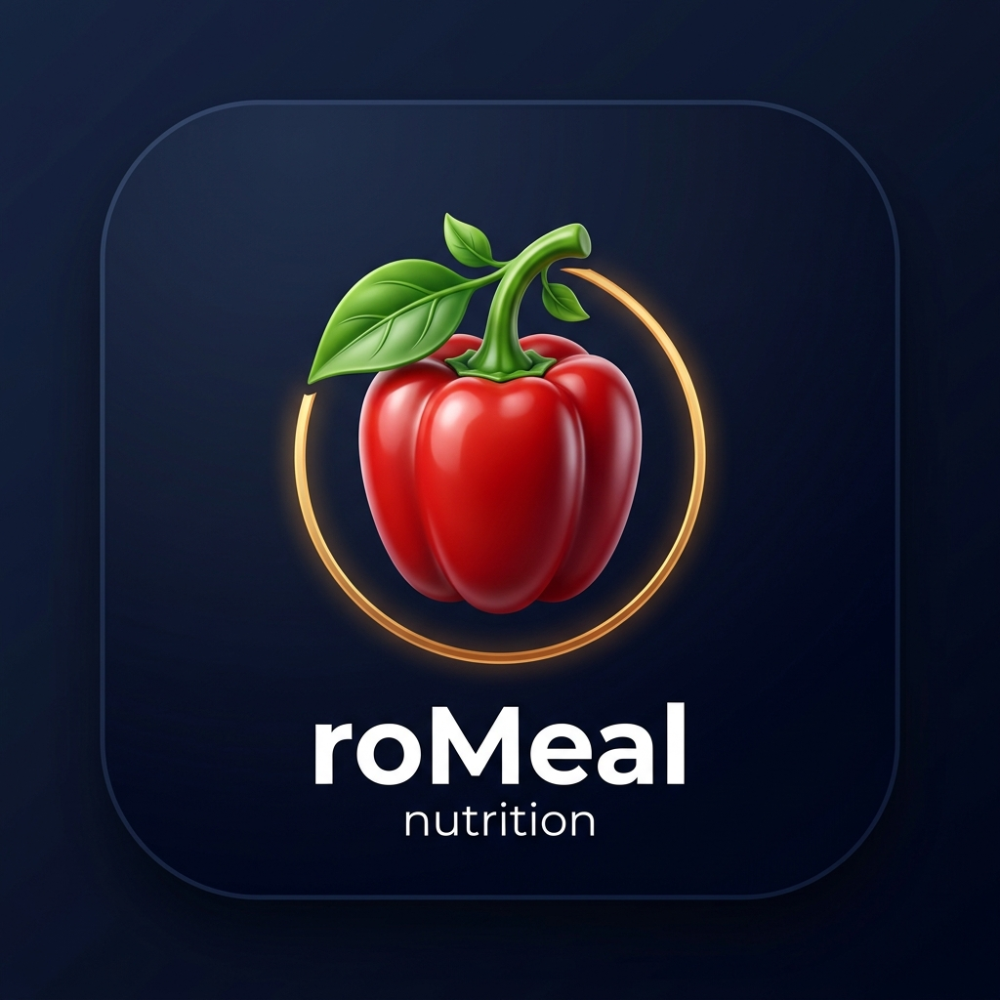
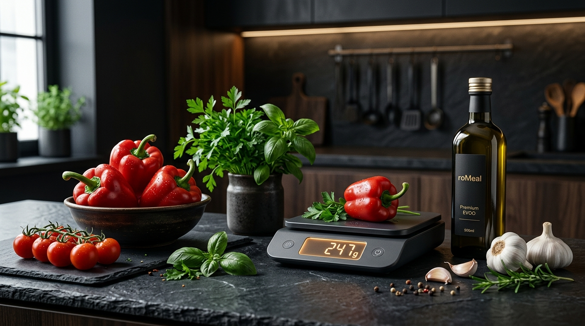

<div align="center">
  
  <h1>roMeal</h1>
  <p><strong>Planificator Inteligent de Mese, Nutriție Concierge & Buget Alimentar adaptat României 🇷🇴</strong></p>
  <p><em>Cântărești crud la gătit, mănânci echilibrat în farfurie. Fără calcule complicate, fără confuzii de gramaje.</em></p>
</div>

<p align="center">
  
</p>

<p align="center">
  <a href="#functionalitati-cheie"></a>
  <a href="https://react.dev/"></a>
  <a href="https://www.typescriptlang.org/"></a>
  <a href="https://tailwindcss.com/"></a>
  <a href="https://vite.dev/"></a>
  <a href="https://firebase.google.com/"></a>
  <a href="https://www.postgresql.org/"></a>
  
</p>

---

## 🌶️ Despre roMeal

**roMeal** este o platformă modernă de nutriție personalizată și planificare alimentară concepută special pentru realitatea pieței din România. Spre deosebire de aplicațiile generice de tracking care creează confuzii legate de ingrediente inaccesibile sau prețuri în valută, **roMeal** rezolvă provocările cotidiene ale gătitului acasă:

1. **⚖️ Dilema Eternă: Cântar Crud vs. În Farfurie**  
   Știi exact câte grame de carne, orez sau legume pui pe cântar când pregătești masa și cât trebuie să ai în farfurie când mănânci după pierderea sau absorbția apei.
2. **🛒 Bugete Reale în RON & Supermarketuri Locale**  
   Rețete optimizate pe produsele disponibile la raft în Kaufland, Lidl, Mega Image, Penny, Carrefour sau Auchan.
3. **🛡️ Siguranță Digestivă & Excludere Alergeni**  
   Filtrare automată pentru gluten, lactoză, arahide, ouă, pește, soia, muștar, țelină și susan.
4. **☁️ Sincronizare Cloud & Autentificare Simplă (Firebase)**  
   Conectare instantanee cu Google sau Email. Planul alimentar și lista de cumpărături sunt sincronizate în timp real între telefon, tabletă și laptop.

---

<a id="functionalitati-cheie"></a>
## ✨ Funcționalități Cheie

### 1. 🧮 Calculator Metabolic Avansat (Mifflin-St Jeor)
* Calculează **BMR** (Rata Metabolică Bazală) și **TDEE** (Consumul Energetic Total Zilnic) pe baza sexului, vârstei, înălțimii, greutății și nivelului de activitate fizică (sedentar, moderat, activ, atlet).
* Distribuie inteligent caloriile și macronutrienții (proteine, carbohidrați, grăsimi, fibre) în funcție de obiectiv: **Slăbire sustenabilă**, **Menținere** sau **Creștere masă musculară**.

### 2. 🍽️ Planificator Săptămânal pe 7 Zile cu Schimb de Mese (Smart Swap)
* Generare automată a celor 7 zile din săptămână (Mic Dejun, Prânz, Cină, Gustări opționale).
* Buton de **Schimbă Masa** cu filtrare instantanee a alternativelor care respectă același profil caloric și exclud alergenii utilizatorului.

### 3. ⚖️ Convertor Inteligent de Greutate: Crud vs. Gătit
* Fiecare rețetă include indici biometrici de retenție sau evaporare a apei:
  * Carne și pește: pierdere ~25-30% din greutate prin frigere/coacere.
  * Orez, paste, leguminoase: creștere de 2.2x – 3x prin hidratare și fierbere.
  * Legume sotate: micșorare volum și condensare a fibrelor.
* În interfață poți comuta cu un singur click între vizualizarea **Ambele**, **Doar Crud** sau **În Farfurie**.

### 4. 🛒 Listă Inteligentă de Cumpărături Agregată & Export
* Cumulează automat toate ingredientele necesare pentru săptămână, ajustate la numărul de membri din familie/gospodărie.
* Împărțire clară pe raioane de supermarket (*Legume & Fructe*, *Carne & Pește*, *Lactate & Ouă*, *Băcănie & Condimente*, *Panificație*).
* Bife interactive memorate automat pentru bifarea produselor direct pe telefon în magazin.
* Export cu un singur click optimizat pentru **WhatsApp, SMS sau Notițe**.

### 5. 🌍 Catalog Rețete & Integrare Spoonacular API
* Catalog nutrițional bogat inclus nativ în aplicație, adaptat bucătăriei din România.
* Suport opțional pentru conectarea unei chei API **Spoonacular** pentru acces la peste 300.000 de rețete internaționale cu import direct în interfață.

---

## 🛠️ Stack Tehnologic

| Nivel | Tehnologie | Descriere |
| :--- | :--- | :--- |
| **Frontend** | React 19 + TypeScript | Componente funcționale modulare cu type-safety strict |
| **Styling** | Tailwind CSS v4 | Design system luxury dark mode (`#080c12`), accente ambră/auriu și smarald |
| **Tooling** | Vite 6 | Build ultrarapid și Hot Module Replacement |
| **Icons** | Lucide React | Pictograme vectoriale minimaliste |
| **Backend Cloud** | Firebase (Firestore & Auth) | Autentificare securizată cu Google / Email și sincronizare date în cloud (Plan Gratuit) |
| **Bază de date** | PostgreSQL 15+ (Schema inclusă) | Tabele relaționale pentru utilizatori, profiluri, rețete, ingrediente și planuri |
| **Persistență Locală** | LocalStorage / IndexedDB | Funcționează offline instant fără configurări complexe |
| **APIs** | Spoonacular Nutrition API | Sursă opțională pentru rețete globale și macro-nutrienți |

---

## 📁 Structura Proiectului

```bash
roMeal/
├── src/
│   ├── assets/
│   │   └── images/              # Logo-ul roMeal (gogoșar 3D) și bannerul oficial
│   ├── components/
│   │   ├── Header.tsx           # Navigare principală, profil și indicatori magazin
│   │   ├── MealPlanView.tsx     # Vizualizarea planului pe 7 zile cu macro-progress
│   │   ├── RecipeDetailModal.tsx# Fereastră detaliu rețetă cu gramaj dublu (crud/farfurie)
│   │   ├── MealSwapModal.tsx    # Modal de înlocuire rapidă a meselor
│   │   ├── ShoppingListView.tsx # Lista de cumpărături pe categorii de supermarket
│   │   ├── RecipeCatalogView.tsx# Catalogul de rețete cu căutare și filtre
│   │   ├── ProfilingWizard.tsx  # Chestionar pas-cu-pas pentru stabilirea obiectivelor
│   │   ├── SettingsModal.tsx    # Configurare cheie Spoonacular & management date
│   │   ├── AuthModal.tsx        # Autentificare Google/Email & creare cont
│   │   └── DatabaseSchemaView.tsx# Vizualizator schemă SQL PostgreSQL
│   ├── services/
│   │   ├── firebase.ts          # Sincronizare Cloud Firestore & Autentificare Google/Email
│   │   ├── db.ts                # Serviciu de persistență și caching
│   │   ├── planner.ts           # Motorul algoritmic de generare a planurilor alimentare
│   │   ├── weightConverter.ts   # Algoritm calcul gramaj crud vs. gătit
│   │   ├── spoonacular.ts       # Client API integrat pentru Spoonacular
│   │   └── shoppingList.ts      # Agregator și optimizator listă de ingrediente
│   ├── types/
│   │   └── index.ts             # Definiții de tipuri TypeScript (Rețete, Profil, etc.)
│   ├── App.tsx                  # Punctul central de coordonare a stării
│   ├── index.css                # Stiluri globale Tailwind și animații personalizate
│   └── main.tsx                 # Entrypoint React
├── public/
├── index.html                   # Entry HTML cu SEO și OpenGraph optimizat
├── metadata.json                # Configurație AI Studio
├── firestore.rules              # Reguli oficiale de securitate Firestore
└── README.md                    # Documentația completă a proiectului
```

---

## 🚀 Instalare și Rulare Locală

### Cerințe preliminare
* **Node.js** (v18.0.0 sau mai recent)
* **npm** sau **yarn / pnpm**

### Pași de instalare

1. **Clonează depozitul:**
   ```bash
   git clone https://github.com/your-username/roMeal.git
   cd roMeal
   ```

2. **Instalează dependențele:**
   ```bash
   npm install
   ```

3. **Configurează variabilele de mediu (Opțional):**
   Dacă dorești să folosești Spoonacular API fără introducere manuală în UI, creează fișierul `.env`:
   ```bash
   VITE_SPOONACULAR_API_KEY=cheia_ta_aici
   ```

4. **Pornește serverul de dezvoltare:**
   ```bash
   npm run dev
   ```
   Aplicația va rula la adresa: `http://localhost:3000` (sau `http://localhost:5173`).

5. **Build pentru producție:**
   ```bash
   npm run build
   ```

---

## 🗄️ Baza de Date & Cloud Sync

* **Cloud Firestore:** Datele utilizatorilor, planurile săptămânale și listele de cumpărături sunt sincronizate automat în cloud la autentificare. Regulile din `firestore.rules` asigură protecția strictă pe baza UID-ului fiecărui utilizator.
* **PostgreSQL (Opțional pentru Backend Relațional):** Proiectul include o schemă completă PostgreSQL pregătită pentru producție în fișierul `src/db/schema.sql` și vizibilă direct în tab-ul **„Schema”** din interfață.

---

## 🤝 Contribuții

Contribuțiile sunt binevenite! Dacă ai idei de îmbunătățire a catalogului de rețete românești sau optimizări de algoritmi:
1. Fă un **Fork** proiectului
2. Creează un branch nou: `git checkout -b feature/reteta-noua`
3. Salvează modificările: `git commit -m 'Adaugă rețetă nouă'`
4. Trimite pe branch: `git push origin feature/reteta-noua`
5. Deschide un **Pull Request**

---

## 📄 Licență

Acest proiect este licențiat sub termenii licenței **MIT**.

---

<div align="center">
  Construit cu pasiune pentru nutriție curată și gătit inteligent în România. 🇷🇴<br />
  <strong>roMeal</strong> — Cântărești crud, mănânci echilibrat în farfurie.
</div>

---

### 🏷️ Hashtags
`#roMeal` `#nutrition` `#mealplanner` `#diet` `#romania` `#kaufland` `#lidl` `#healthtech` `#macros` `#react19` `#typescript` `#tailwindcss` `#firebase` `#postgresql` `#spoonacular` `#gogosar` `#fitness`
